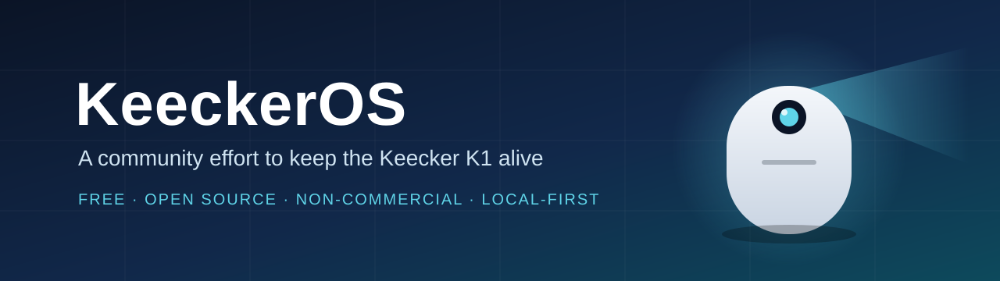
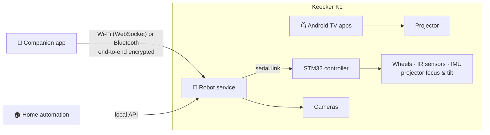

  

  
  
  
  

  <a href="#why">Why</a> ·
  <a href="#what-we-are-building">What we are building</a> ·
  <a href="#progress">Progress</a> ·
  <a href="#how-it-works">How it works</a> ·
  <a href="#roadmap">Roadmap</a> ·
  <a href="#principles">Principles</a> ·
  <a href="#documentation">Documentation</a>

---

## Why

The Keecker K1 was a home robot well ahead of its time: a projector on wheels, with a 360° camera, speakers,
mapping and a companion app. Keecker has since closed, its cloud services are gone, and more than a thousand K1
robots remain in homes, running an Android TV 7 that today's apps no longer support.

**KeeckerOS is a volunteer, community project to give these robots a second life.** It is free and open source.
There is no company behind it, nothing to sell and no advertising. The only goal is that every owner who wishes can
install an up-to-date system on their own K1, themselves.

## What we are building

| | Component | Purpose |
|---|---|---|
| 📺 | **Recent Android TV** | A LineageOS Android TV build for the K1 (Android 11 first). Today's TV and streaming apps, and casting from a phone |
| 🤖 | **Open robot service** | Runs on the robot, with no server: driving, docking, mapping, projector focus and tilt, camera, surveillance |
| 📱 | **Open companion app** | Pairs with the robot locally over Wi-Fi or Bluetooth. Designed to also work with current K1 robots, before any reinstall |
| 🏠 | **Local API** | A documented local interface, so the robot can join home-automation setups |
| 🧰 | **Owner installer** | Backs up the robot (including its per-unit calibration), then installs the new system |

## Progress

| Area | Status | Details |
|---|---|---|
| Hardware platform | ✅ Identified | Intrinsyc Open-Q 820 module (Snapdragon 820), STM32 motion microcontroller, sensors and projector · [platform.md](docs/07-Hardware/platform.md) |
| Motion controller link | ✅ Documented | Serial link to the STM32: port settings, frame format, command set · [stm32-protocol.md](docs/05-Interfaces/stm32-protocol.md) |
| Companion app protocol | ✅ Documented | Discovery, WebSocket and Bluetooth transports, pairing handshake, encryption · [remote-app-protocol.md](docs/05-Interfaces/remote-app-protocol.md) |
| Feature inventory | ✅ First version | Everything the K1 did, and how each feature will come back · [FEATURES.md](docs/04-Analysis/FEATURES.md) |
| Test client for the protocol | 🔄 Ready, live test pending | Pair with a robot and drive the projector from a computer · [remote-client.md](docs/10-Operations/remote-client.md) |
| Bootloader and backup | ⏳ Next | Read-only check on a robot, full backup procedure · [adb-runbook.md](docs/10-Operations/adb-runbook.md) |
| Android TV build | ⏳ Planned | LineageOS on the msm8996 family (same chip as the Xiaomi Mi 5) |

Every statement in the documentation is backed by evidence and marked ✅ confirmed, 🟡 probable or 🔴 hypothesis.

## How it works

## Roadmap

1. **Understand** the robot: hardware, software, protocols. *Largely done.*
2. **Talk to today's robots** with an open client and an open companion app.
3. **Check the bootloader** and write a safe, complete backup procedure.
4. **Boot a recent Android TV** on the K1: display, Wi-Fi, audio.
5. **Bring the robot back**: driving, docking, mapping, surveillance, touch projection, voice.
6. **Package it for owners**: installer, guides, public release.

Details: [ROADMAP.md](ROADMAP.md).

## Principles

- **Community first.** Volunteer work, free for everyone, no commercial goal.
- **Respect for the original work.** The Keecker team built a remarkable product; this project documents it carefully
  and credits it.
- **No Keecker files are redistributed.** No firmware, application or library from Keecker is published here.
  Each owner works from what is already on their own robot. Keecker's public repositories are referenced with
  attribution: the SDK [`services-api`](https://github.com/keecker/services-api) (Apache 2.0) and the protocol
  definitions [`remote-api`](https://github.com/keecker/remote-api) (published without a license, so read and
  documented here, not copied).
- **Privacy and safety.** The robot has cameras and lives in living rooms: no cloud dependency, remote access off by
  default, no default passwords, signed updates. Motion safeties are never disabled.
- **Evidence over guesswork.** Facts, sources and hypotheses are kept apart.

## Documentation

| Folder | Content |
|---|---|
| [docs/](docs/INDEX.md) | Technical documentation, organised by domain (architecture, hardware, interfaces, analysis, operations) |
| [handbook/](handbook/) | Engineering handbook |
| [scripts/](scripts/INDEX.md) | Utilities, such as the read-only robot snapshot |
| [explorer/](explorer/) | Network discovery tool used in the first phase |
| [CHANGELOG.md](CHANGELOG.md) | What changed, and when |

Start with [docs/INDEX.md](docs/INDEX.md), then [System-Architecture.md](docs/01-Architecture/System-Architecture.md).

## Get involved

You own a K1, worked on it, or simply want to help? Contributions, test reports and memories of how the robot
worked are all welcome. See [CONTRIBUTING.md](CONTRIBUTING.md). Security findings: [SECURITY.md](SECURITY.md).

## License

[Apache License 2.0](LICENSE). The license covers the original work in this repository; see [NOTICE](NOTICE).

---

KeeckerOS is an independent community project. It is not affiliated with, endorsed by or sponsored by Keecker SAS.
"Keecker" is used only to describe the hardware this project supports; "KeeckerOS" is a working name.
